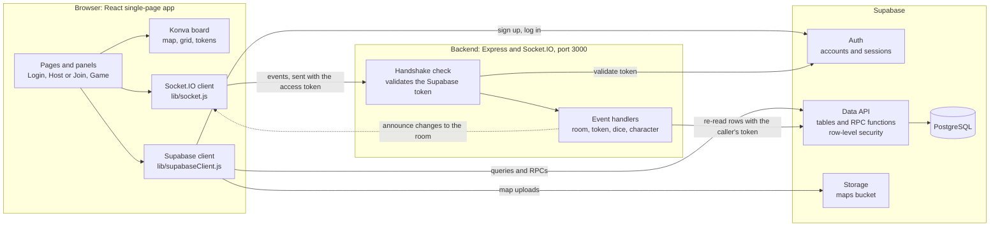
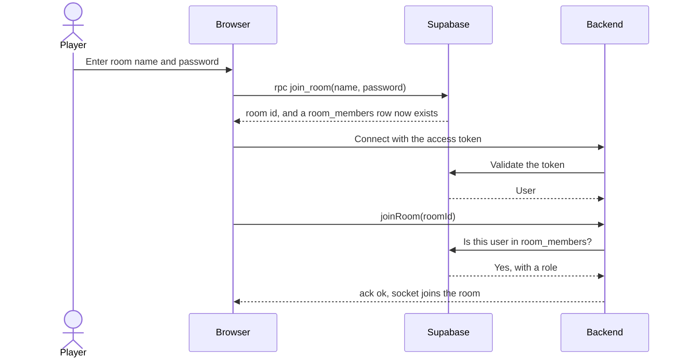
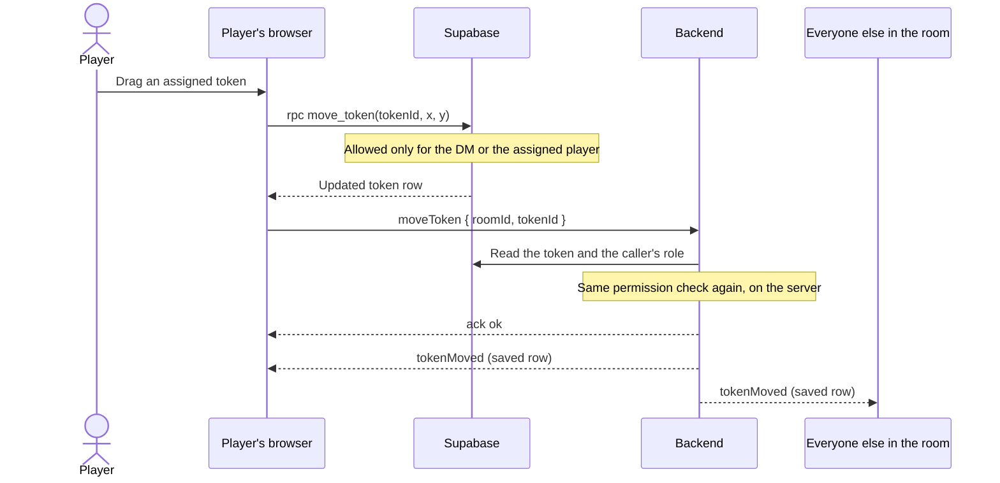
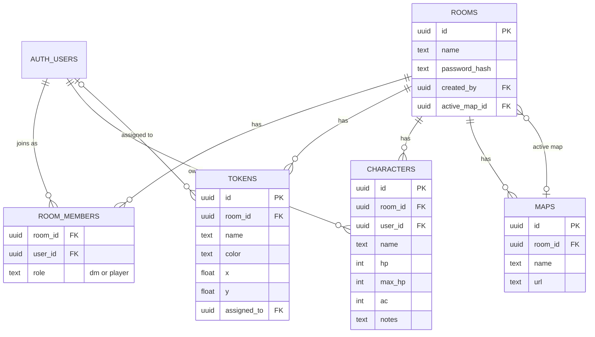

# Architecture diagrams

These diagrams show how the oPeN VTT browser app, the backend, and Supabase fit together. GitHub draws them from the text below. For versions and the list of UI components, see [architecture.md](agent/architecture.md).

The design follows one rule: **Supabase holds anything that must persist, and Socket.IO only announces changes.** Security is enforced in the database (row-level security) and in the backend's checks on each socket event, never only in the browser.

## System overview

How to read it:

- The browser talks to Supabase directly for sign-in, saving data, and map uploads. There are no REST routes in the backend.
- The backend only runs Socket.IO. It checks who is connecting, checks they belong to the room, reads the row back from Supabase with the caller's own token (so row-level security still applies), and then tells everyone in the room.
- The dashed line is the broadcast back to the browsers in the room.

## Who is responsible for what

| Concern                                | Where it happens                                                               |
| -------------------------------------- | ------------------------------------------------------------------------------ |
| Accounts and sessions                  | Supabase Auth                                                                  |
| Saving rooms, tokens, characters, maps | Supabase tables, written from the browser through the Supabase client          |
| Who may do what                        | Row-level security policies and RPC functions in `backend/supabase/migrations` |
| Map image files                        | Supabase Storage, `maps` bucket, one folder per room                           |
| Live updates in a room                 | Socket.IO events in `backend/src/sockets`                                      |
| Rolling dice                           | The backend. The server rolls, so a client cannot choose its result            |
| UI-only state                          | React state in the browser, such as panel positions and the camera             |

## Joining a room

## Moving a token

This is the pattern every live update follows: save first, then announce.

The backend never trusts position data from the client. It re-reads the saved row and broadcasts that.

Character HP changes work the same way (`update_character`, then `characterUpdated`). DM token changes (`tokenAdded`, `tokenUpdated`, `tokenRemoved`) also save first and announce second, but they are sent to everyone except the DM. Dice are the exception: nothing is saved, and the server rolls and broadcasts `diceResult`. The event names and payloads live in `backend/src/sockets`.

## Data model

A user's role belongs to the room, not to the account, so the same person can be the DM of one room and a player in another. Deleting a room removes its members, tokens, characters, and maps. The policies behind this model are in `backend/supabase/migrations`.
