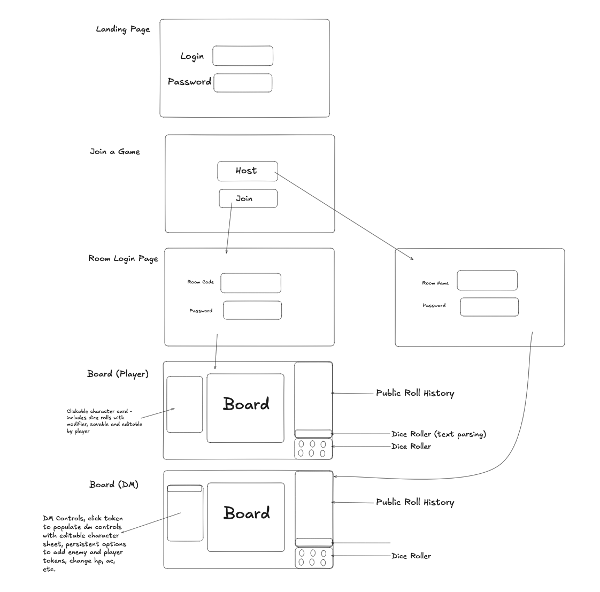
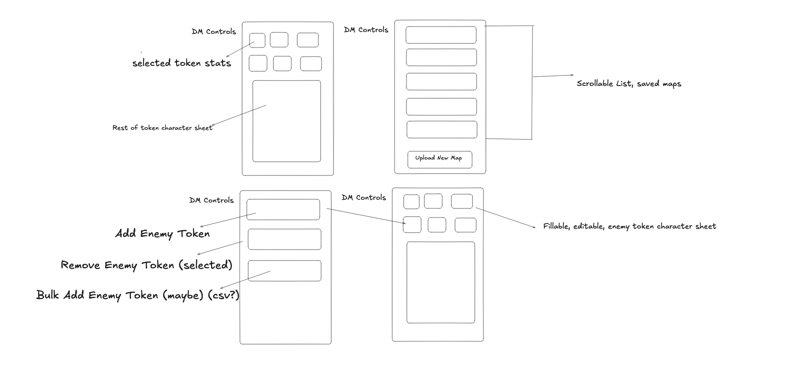

# oPeN VTT — Design

## Color Palette

Source: [coolors.co palette](https://coolors.co/d0b8ac-f3d8c7-efe5dc-fbfefb-ffffff)

| Name | Hex | RGB | Role |
| --- | --- | --- | --- |
| Rosy Brown | `#D0B8AC` | `208, 184, 172` | Primary accent — buttons, active states, highlights |
| Champagne Pink | `#F3D8C7` | `243, 216, 199` | Secondary accent — panels, cards, hover states |
| Almond | `#EFE5DC` | `239, 229, 220` | Surface — secondary backgrounds, dividers |
| Mint Cream | `#FBFEFB` | `251, 254, 251` | Background — primary app background |
| White | `#FFFFFF` | `255, 255, 255` | Base — cards, inputs, elevated surfaces |

### CSS Custom Properties

```css
:root {
  --color-primary: #d0b8ac;   /* Rosy Brown */
  --color-secondary: #f3d8c7; /* Champagne Pink */
  --color-surface: #efe5dc;   /* Almond */
  --color-background: #fbfefb;/* Mint Cream */
  --color-base: #ffffff;      /* White */
}
```

## Typography

Primary typeface: [Vollkorn](https://fonts.google.com/specimen/Vollkorn) (variable font, weights 400–900).

Load the font:

```css
@import url('https://fonts.googleapis.com/css2?family=Vollkorn:wght@400..900&display=swap');
```

Apply it (replace the weight with any value from 400 to 900, and use a descriptive class name):

```css
.vollkorn-regular {
  font-family: "Vollkorn", serif;
  font-optical-sizing: auto;
  font-weight: 400;
  font-style: normal;
}

.vollkorn-bold {
  font-family: "Vollkorn", serif;
  font-optical-sizing: auto;
  font-weight: 700;
  font-style: normal;
}
```

## Mockups

Low-fidelity wireframes for the core flows and screens.

### General Flow



Covers the full path: **Landing Page** (login + password) → **Join a Game** (Host / Join) → **Room Login Page** (room code + password to join, or room name + password to host) → **Board**. The Board has two variants:

- **Board (Player)** — clickable character card (dice rolls with modifier, savable/editable by the player), the map Board, a Public Roll History panel, and a Dice Roller (both a text-parsing input and dice buttons).
- **Board (DM)** — same layout plus DM Controls: click a token to populate an editable character sheet, add/remove enemy and player tokens, change HP/AC, etc.

### DM Controls



DM-only panel details:

- **Selected token stats** — quick stat tiles plus the rest of the token's character sheet.
- **Map management** — scrollable list of saved maps and an **Upload New Map** button.
- **Token management** — Add Enemy Token, Remove Enemy Token (selected), and a possible Bulk Add Enemy Token (CSV?).
- **Enemy character sheet** — fillable, editable sheet for enemy tokens.

## Token Colors

Tokens must be visually distinct and, per the accessibility rules in [AGENTS.md](../AGENTS.md), always pair color with a text label (never color alone).

> **Note:** These are placeholder colors for default/generated tokens. The goal is to let DMs and players upload images for tokens, so these act as fallbacks until a custom image is set.

| Token | Hex | Suggested use |
| --- | --- | --- |
| Red | `#E6194B` | Enemy / hostile |
| Blue | `#4363D8` | Player |
| Green | `#3CB44B` | Player / ally |
| Orange | `#F58231` | Player |
| Purple | `#911EB4` | Player |
| Teal | `#469990` | NPC / neutral |
| Yellow | `#FFE119` | NPC / objective |
| Pink | `#F032E6` | Player |

These are chosen for maximum mutual contrast so overlapping tokens on the board stay distinguishable.
